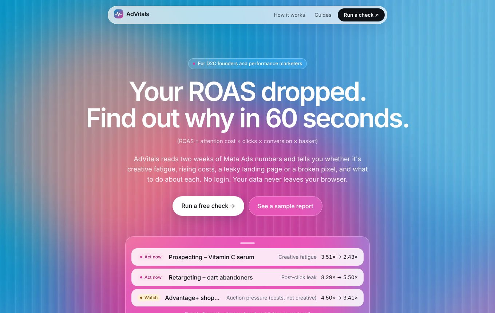
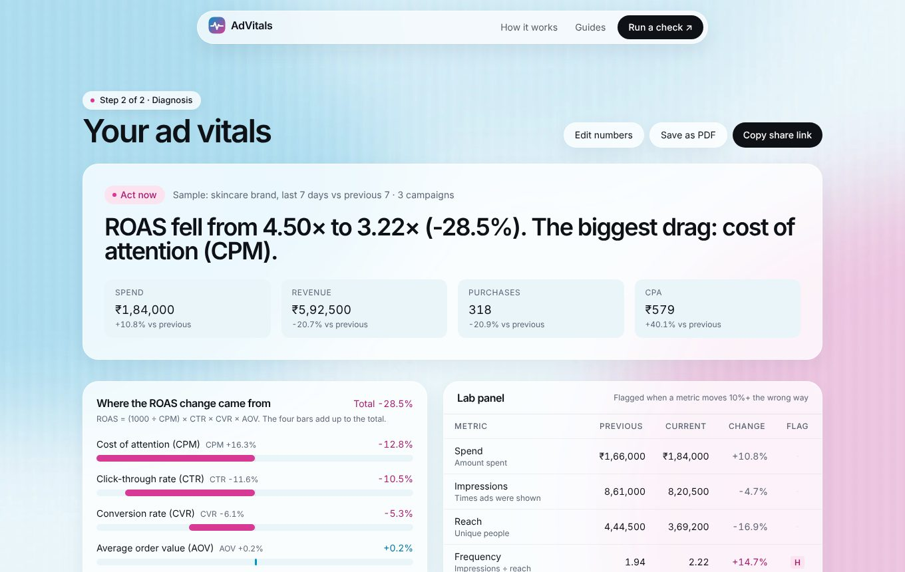

# AdVitals

[](https://github.com/meherkaur111/advitals/actions/workflows/ci.yml)

**A 60-second health check for Meta ads.** Give it two weeks of Ads Manager numbers and it tells you *why* ROAS moved (creative fatigue, auction pressure, a post-click leak, a tracking break, audience saturation or smaller baskets) and what to do about each one.

Built for D2C founders and performance marketers who see ROAS drop and need to know which team owns the fix before they start refreshing creative by reflex.




## How it works

ROAS is four numbers multiplied together:

```
ROAS = (1000 / CPM) × CTR × CVR × AOV
```

1. **Decomposition.** Taking logs turns the product into a sum, so any ROAS change splits *exactly* into the share caused by cost (CPM), clicks (CTR), conversion (CVR) and basket size (AOV). The four contributions add up to the total change.
2. **Significance.** CTR and CVR changes are run through a two-proportion z-test, so small-sample noise isn't reported as a problem.
3. **Pattern matching.** Lever movements are matched to known causes with explicit thresholds (see `T` in `src/lib/diagnose.ts`). For example, CTR down and significant plus frequency up means fatigue. CVR collapsing while CTR holds means tracking is checked before customers are blamed.
4. **Roll-up honesty.** Each campaign is diagnosed on its own. The account headline takes the worst campaign's verdict, so a healthy total can't hide a broken campaign.

## Privacy by design

There is no backend and no database of user numbers. The diagnosis runs in the browser. Share links encode the inputs in the URL fragment (`#…`), which browsers never send to a server. Recent reports are kept in `localStorage`. Form and report areas are masked from Clarity session recordings.

## Stack

- Next.js 16 (App Router), React 19, TypeScript, Tailwind CSS 4
- PapaParse for Meta Ads Manager CSV exports (header aliasing handles currency suffixes, `Link clicks` vs `Clicks (all)`, BOMs, summary rows and comma-formatted numbers)
- Vitest unit + fuzz tests, Playwright end-to-end tests with axe accessibility checks
- Hosted on Vercel. Microsoft Clarity for analytics. Google Search Console via meta tag.
- SEO: per-page metadata, generated sitemap/robots, dynamic Open Graph image, JSON-LD (SoftwareApplication, FAQPage, Article), two guides under `/blog`

## Project structure

```
src/lib/metrics.ts     Types, derived metrics, input validation
src/lib/stats.ts       Two-proportion z-test
src/lib/diagnose.ts    ROAS decomposition + rule engine + account roll-up
src/lib/csv.ts         Meta CSV parsing and period matching
src/lib/share.ts       Compact, validated share-link encoding
src/components/        CheckForm (manual + CSV input), ReportView
src/app/               Landing, /check, /report, /blog, /privacy, sitemap, robots, OG image
```

## Error handling

- Field-level validation (empty, non-numeric, negative, clicks > impressions, purchases > clicks, revenue without purchases) with highlighted inputs
- CSV: names missing columns in plain language, skips bad rows with a warning, reports campaigns that only ran in one period, rejects files over 5 MB
- Damaged or truncated share links show a clear error page instead of crashing
- Divide-by-zero cases return `null` and render as "—"; the decomposition degrades gracefully when there are zero purchases
- `localStorage` and analytics are wrapped so they can never break the app
- One-tap "Was this useful?" feedback sent as a Clarity event (no backend, no ad data)
- App-level `error.tsx` and `not-found.tsx`; security headers set in `next.config.ts`

## Quality

| Check | Result |
| --- | --- |
| Unit tests (engine, CSV, share links) | 27 passing |
| Fuzz tests | 5,000 random accounts and 2,000 garbage links: no crash, no NaN, decomposition always sums exactly |
| End-to-end (Playwright, desktop + mobile) | 22 passing: manual entry, CSV upload, validation, share link round-trip, history, damaged links, 404, feedback, scroll |
| Accessibility (axe, WCAG 2 A/AA) | 0 violations on landing, form, report and guides |
| Lighthouse (local, mobile preset) | Performance 95–99 · Accessibility 100 · Best Practices 100 · SEO 100 |
| CI | Lint, typecheck, unit tests, build and e2e on every push |

## Run locally

```bash
npm install
cp .env.example .env.local   # set NEXT_PUBLIC_SITE_URL
npm run dev                  # http://localhost:3000
npm test                     # unit + fuzz tests
npm run build                # production build
npm run test:e2e             # end-to-end + accessibility (needs `npx playwright install chromium` once)
```

## Environment variables

| Variable | Required | Purpose |
| --- | --- | --- |
| `NEXT_PUBLIC_SITE_URL` | Yes (prod) | Canonical URL, sitemap, OG |
| `NEXT_PUBLIC_CLARITY_ID` | No | Microsoft Clarity project ID |
| `NEXT_PUBLIC_GSC_VERIFICATION` | No | Google Search Console meta-tag code |

## Built with AI

Built with Claude as a pair programmer. The engine, tests and UI were developed iteratively, and AI was also used to audit the work: fuzz testing surfaced edge cases, automated accessibility scans caught colour-contrast failures, and screenshot reviews caught layout bugs (mobile overflow, the report opening mid-page). Each fix landed with a regression test.

---

Built by [Meher Saluja](https://www.linkedin.com/in/mehersaluja).
